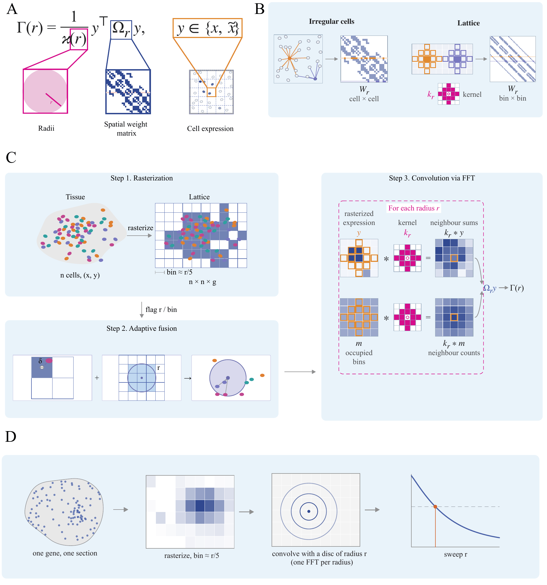

# Spectrast

Multiscale spatial statistics for single-cell spatial transcriptomics, computed as FFT convolutions
on a lattice.

**Documentation, tutorials and API reference: [spectrast.readthedocs.io](https://spectrast.readthedocs.io)**

Spectrast measures how each gene or cell type is spatially organized at every length scale. It
computes Moran's I, Geary's C, Getis-Ord General G, LOSH, focality and texture as curves over
radius, and tests whether that organization changes between conditions. It works on Xenium,
MERFISH, CosMx and Visium HD data in AnnData and follows the scanpy/squidpy layout: `gr` computes,
`pl` plots.

<p align="center">
  
</p>

- **A.** Each statistic is a normalised quadratic form of a gene's expression *y* under the
  spatial weight matrix Ω<sub>r</sub> at radius *r*.
- **B.** On irregular cells the weight matrix is a cell × cell graph. On a lattice it becomes a
  convolution kernel *k*<sub>r</sub>.
- **C.** Spectrast rasterizes cells onto a lattice (bin ≈ *r*/5). Cells where *r* is small
  relative to the bin are computed exactly on the cell graph (adaptive fusion). Every other
  neighbour sum and count is an FFT convolution.
- **D.** Sweeping *r* turns each gene into a curve, which is then reduced to a characteristic
  scale.

| Question | Entry point |
|---|---|
| At what length scale is each gene organized, and how strongly? | `gr.organization`, `gr.fingerprint` |
| Is a gene's curve significant at each radius? (Optionally within cell types: `strata_key=`) | `gr.moran_null` |
| Where are the hotspots, cold spots and boundaries? | `gr.local_moran`, `gr.getis_ord`, `gr.local_geary`, `gr.losh` |
| Did organization change between two conditions, and at which radii? | `diff.differential`, `diff.differential_cohort` |
| What can this section support? | `qc.section_report` |
| How do I plot any of the above? | `spectrast.pl` |

## Install

```bash
pip install "spectrast[full] @ git+https://github.com/gingerii/spectrast.git"
```

The core package needs only numpy, scipy, pandas and psutil. `[full]` adds scanpy, anndata,
matplotlib and scikit-learn. Python 3.10 or later.

## Quick start

```python
import scanpy as sc
import spectrast
from spectrast import gr, pl, diff

# one section; cell coordinates in µm in adata.obsm["spatial"]
adata = sc.read_h5ad("section.h5ad")

# each gene's Moran's I curve over radius -> characteristic scale, amplitude
tab = gr.organization(adata, stats=("moran",))
pl.scale_plane(tab)

# a few genes' curves against a calibrated per-gene, per-radius null
genes = ["CXCL13", "CCL19", "MS4A1"]
gr.fingerprint(adata, genes=genes)         # stores the curves in adata.uns
null = gr.moran_null(adata, genes=genes)
pl.curves(adata, genes, null=null)

# where each cell type sits on the tissue's length scale
pl.celltype_ladder(gr.celltype_scale(adata, "cell_type"))

# two conditions: cohort is one AnnData of many sections, with obs columns
# "condition" and "section_id"; which genes reorganize, and over which radii?
res, curves = diff.differential_cohort(
    cohort, "condition", ["case"], ["control"],
    sample_key="section_id", axis="moran", return_curves=True)
pl.volcano(res)
pl.diff_curves(curves, res.sort_values("p").gene.iloc[0])
```

Radii default to 19 log-spaced values from 2 to 40 times the section's median nearest-neighbour
distance.

## Compute backends

The default backend is the CPU: double precision, multithreaded, no torch required. GPU backends
run the transforms in single precision through torch.

```python
spectrast.set_backend("cuda")    # NVIDIA:        pip install "spectrast[full,cuda] @ git+..."
spectrast.set_backend("mps")     # Apple silicon: pip install "spectrast[full,mps] @ git+..."
spectrast.set_backend("auto")    # the best available
```

## License

MIT. See `LICENSE`.
